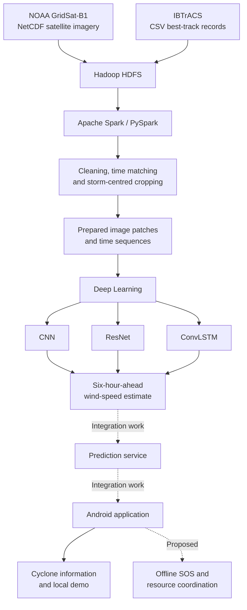

# CycloneConnect

**Satellite-Based Tropical Cyclone Wind-Speed Prediction and Disaster-Management Application**

CycloneConnect is an academic project that brings together Big Data Analytics, Deep Learning, and Android application development to explore two connected challenges:

1. Preparing large-scale satellite and cyclone-track datasets for data-driven tropical cyclone analysis.
2. Building a mobile application that presents cyclone-related information and is intended to support emergency preparedness and coordination.

The current deep-learning work focuses on **six-hour-ahead cyclone wind-speed regression** from satellite imagery. The Android application is a prototype with a bundled TensorFlow Lite prediction demonstration and Firebase-based account functionality. Offline emergency communication and resource coordination are proposed extensions, not currently implemented features.

> **Research prototype:** CycloneConnect is not an operational forecasting or emergency-warning system. Its experimental predictions must not replace official advisories from the India Meteorological Department (IMD) or other competent authorities.

---

## Contents

- [Project Motivation](#project-motivation)
- [Project Objectives](#project-objectives)
- [System Overview](#system-overview)
- [Big Data Analytics Pipeline](#big-data-analytics-pipeline)
- [Datasets](#datasets)
- [Deep Learning Approach](#deep-learning-approach)
- [Experimental Results](#experimental-results)
- [Android Application](#android-application)
- [Proposed Offline Emergency Features](#proposed-offline-emergency-features)
- [Technology Stack](#technology-stack)
- [Repository Structure](#repository-structure)
- [Setup and Execution](#setup-and-execution)
- [Current Implementation Status](#current-implementation-status)
- [Limitations and Future Work](#limitations-and-future-work)
- [Team](#team)
- [References](#references)

---

## Project Motivation

Tropical cyclones affecting the Bay of Bengal and Arabian Sea can cause severe damage to coastal communities. Timely estimates of cyclone intensity and wind speed can contribute to preparedness, risk assessment, and response planning.

Satellite imagery provides repeated observations of cyclone cloud structures, while best-track datasets contain storm locations and observed wind speeds. These sources are maintained separately and must be cleaned, aligned in time and space, and transformed into labelled image samples before they can be used for machine learning. The size and format of the satellite archive make this a distributed data-processing challenge.

A second challenge arises during disasters: cellular networks and internet connectivity may be disrupted. People may then have difficulty communicating urgent needs or coordinating access to food, drinking water, medical assistance, and shelters.

CycloneConnect explores an integrated approach: a data and modelling pipeline for satellite-based wind-speed estimation, alongside a mobile prototype intended to bring cyclone information and emergency-support functions closer to users.

## Project Objectives

- Build a distributed Hadoop HDFS and Apache Spark environment across two laptops.
- Ingest NOAA GridSat-B1 satellite imagery and IBTrACS cyclone best-track records.
- Clean and align cyclone observations with satellite scans.
- Extract storm-centred image patches and prepare time-series samples.
- Train and compare CNN, ResNet-style CNN, and ConvLSTM regression models.
- Evaluate six-hour-ahead wind-speed predictions using MAE and RMSE.
- Develop an Android application using Kotlin and Jetpack Compose.
- Demonstrate on-device inference using TensorFlow Lite.
- Explore future offline SOS communication, message prioritisation, and decentralised resource coordination.

---

## System Overview

The project is organised into four broad areas:

1. **Big Data processing:** Hadoop HDFS and Spark are used to store and prepare satellite and cyclone-track data.
2. **Deep Learning:** CNN-based models learn from satellite image patches; ConvLSTM additionally processes a sequence of images.
3. **Prediction integration:** Model outputs are intended to be exposed through a service and/or used by the mobile application. 
4. **Android application:** A Kotlin/Jetpack Compose prototype provides the mobile interface and a local TensorFlow Lite prediction demonstration.



The diagram combines the intended end-to-end design with the current modelling and Android work. Dashed connections indicate integration or features that remain future work.

---

## Big Data Analytics Pipeline

### Why Big Data technologies are used

The project combines two different data types:

- Satellite observations: large gridded NetCDF files, with GridSat-B1 scans available at three-hour intervals.
- Cyclone best-track records: tabular CSV observations containing storm identifiers, timestamps, coordinates, and wind-speed values.

The satellite archive is large, and each satellite scan must be matched to cyclone observations. Processing the files sequentially on one machine can be time-consuming and memory-intensive. The project therefore uses distributed storage and file-level parallel processing.

### Distributed environment

The design uses two Windows 11 laptops with Ubuntu 22.04 under WSL2. The machines are connected through Tailscale so that the distributed services can communicate across separate Wi-Fi networks.

| Node | Planned services |
|---|---|
| Laptop 1 (master) | HDFS NameNode and DataNode; Spark Master and Worker |
| Laptop 2 (worker) | HDFS DataNode; Spark Worker |
| Both machines | Ubuntu 22.04 (WSL2), OpenJDK 11, Python scientific libraries |

The design uses Hadoop HDFS 3.3.6 and Apache Spark 3.5.3 in standalone mode. The project design selected Spark standalone rather than YARN to reduce configuration and memory overhead on the two laptops.

### Processing stages

1. **Data acquisition:** Download the selected GridSat-B1 NetCDF files and the IBTrACS CSV.
2. **Ingestion:** Place the raw datasets in HDFS.
3. **Cleaning:** Trim and parse IBTrACS fields, convert relevant columns to numeric types, remove invalid timestamps, and remove duplicate storm-time records.
4. **Time alignment:** Match cyclone observations with available satellite scan times and derive the six-hour-ahead target wind speed.
5. **Image extraction:** Use xarray/netCDF4 within Spark tasks to read satellite files and extract fixed-size patches centred on cyclone coordinates.
6. **Dataset preparation:** Organise the extracted patches and corresponding labels for model training and evaluation.
7. **Analytics:** Use Spark queries to examine cyclone counts by year and basin, peak wind speeds, and sample distribution.

The current Big Data scripts in the repository include the GridSat download workflow, IBTrACS cleaning, time matching, patch extraction, patch checks, and Spark-based demonstration queries.

### HDFS data organisation

The project design defines the following logical directory layout:

```text
/project/
├── raw/
│   ├── gridsat/
│   │   └── <year>/
│   └── ibtracs/
├── curated/
│   ├── ibtracs/
│   ├── samples_6h/
│   └── patches/
└── processed/
    └── sequences/
```

The design uses a default HDFS block size of 128 MB. Replication is intended to be configured according to available disk capacity, with a replication factor of 2 for processed data where storage permits. Raw imagery may use a lower replication factor when disk space is constrained.

### Parallel processing strategy

NetCDF files are processed at the file level: Spark distributes file paths among workers, and each task reads and processes a file. The smaller cyclone-track table can be broadcast to workers to reduce unnecessary data shuffling.

MongoDB was included in the Big Data design for indexed storm-record lookup and aggregation queries. However, the uploaded repository snapshot contains Spark-based query scripts and does not include a MongoDB integration implementation. Treat MongoDB as a designed component until that integration is added and demonstrated.

---

## Datasets

### NOAA GridSat-B1 Climate Data Record

- **Source:** [NOAA NCEI GridSat-B1](https://www.ncei.noaa.gov/data/geostationary-ir-channel-brightness-temperature-gridsat-b1/access/)
- **Format:** NetCDF
- **Content:** Gridded geostationary satellite infrared brightness-temperature observations.
- **Temporal frequency:** One scan approximately every three hours.
- **Role:** Provides the satellite imagery used as model input.

The latest modelling review describes the use of infrared window and water-vapour channels during data preparation, with Channel 1 selected for the reported model comparison because it had fewer missing-data anomalies.

### IBTrACS — International Best Track Archive for Climate Stewardship

- **Source:** [IBTrACS v4.01](https://doi.org/10.25921/82ty-9e16)
- **Format:** CSV (the archive also provides other formats)
- **Relevant fields:** Storm identifier, timestamp, latitude, longitude, basin, and wind speed.
- **Role:** Supplies storm locations and observed wind-speed values used to align imagery and construct prediction targets.

For the modelling experiment, the target is the cyclone wind speed **six hours after** the input observation time (`TARGET_WIND`). IBTrACS wind-speed values are used as labels/targets; they are not additional input features to the initial satellite-image models.


---

## Deep Learning Approach

The deep-learning component treats cyclone wind-speed estimation as a **regression task**. The models predict a continuous wind-speed value in knots for a time six hours after the input observation.

### Input preparation

- Satellite patches are cropped around cyclone coordinates.
- Each patch is 64 × 64 pixels.
- The reported experiments use Channel 1 (infrared window) inputs.
- Image values are standardised using the mean and standard deviation calculated from the training data.
- Model comparison uses the same 1,013 common test observations.
- The data split is storm-aware, reducing the risk of observations from the same storm appearing across different splits.

The latest review reports 10,814 original patches, of which 10,811 Channel 1 images were usable after skipping three fully missing patches. It also reports 4,290 matched sequence samples.

### CNN baseline

The CNN receives one 64 × 64 satellite image. Convolution and pooling layers extract spatial patterns from the cloud structure, and a regression head produces a single six-hour-ahead wind-speed estimate.

### ResNet-style CNN

The ResNet-style model also receives one 64 × 64 image. It uses residual/skip connections across convolutional blocks to support feature learning in a deeper network. The review reports 409,377 parameters for this model.

### ConvLSTM

The ConvLSTM receives four consecutive 64 × 64 satellite images, each separated by three hours:

- T − 9 hours
- T − 6 hours
- T − 3 hours
- T

The model learns spatial features and how those features evolve over time. It then predicts wind speed at T + 6 hours.

### Training and evaluation

The review describes Huber loss as the primary proposed training objective, with MSE considered for comparison, Adam optimisation, and early stopping based on validation loss. The model notebooks also report training/validation histories and test-set regression metrics.

Evaluation metrics:

- **MAE (Mean Absolute Error):** average absolute difference between predicted and observed wind speed.
- **RMSE (Root Mean Squared Error):** gives greater weight to larger prediction errors.

Both metrics are expressed in knots. Lower values indicate smaller errors on the evaluated test set.

---

## Experimental Results

The three-model comparison notebook in the uploaded repository matches the model predictions by storm identifier and timestamp, verifies that the actual target values agree, and calculates metrics on the **same 1,013 observations**.

| Model | Input | Common test samples | MAE (knots) | RMSE (knots) |
|---|---|---:|---:|---:|
| ResNet | One Channel 1 image with residual connections | 1,013 | **11.3928** | **15.0061** |
| ConvLSTM | Four Channel 1 images, three hours apart | 1,013 | 12.5253 | 17.0156 |
| CNN | One Channel 1 image | 1,013 | 13.6508 | 18.3410 |

**Interpretation:** In the common-sample comparison saved in the repository's `03_Model_Comparison.ipynb`, ResNet records the lowest MAE and RMSE. ConvLSTM performs better than the CNN baseline on both metrics, while ResNet gives the strongest result among these three reported experiments.

The Review 3 presentation contains a different ResNet/CNN comparison table. The values above are taken from the executed comparison notebook output in the uploaded ZIP because that notebook explicitly matches all three models on the same observations. Keep the presentation and notebook results synchronised before using the figures in a final report.

These results describe one experimental dataset and test split. They do not establish operational forecasting skill or guarantee performance on future storms, other basins, or live satellite inputs.

---

## Android Application

The mobile application is developed in Android Studio using Kotlin, Jetpack Compose, and Material 3.

### Application functionality represented in the project

- Home dashboard and navigation structure.
- Light and dark theme support.
- Login and registration screens.
- Firebase Authentication integration in the app configuration and navigation code.
- Profile screen that reflects the signed-in user state.
- Coastal-city search data support.
- TensorFlow Lite prediction code for the bundled cyclone models.
- Screens/routes reserved for emergency information, family and friends, SOS, official alerts, regional news, volunteer support, donations, privacy, help, settings, and about information.

Several of these destinations currently open a “Coming Soon” screen. Their presence in the navigation structure should not be interpreted as completed service functionality.

### On-device wind-speed prediction

The repository includes TensorFlow Lite model files for CNN, ResNet, and ConvLSTM, together with a `CyclonePredictor` implementation that:

1. Selects a model and its expected input shape.
2. Reads preprocessing parameters from a JSON asset.
3. Loads the corresponding model from the app assets.
4. Reads a bundled sample image or sequence from CSV.
5. Standardises pixel values using the stored training mean and standard deviation.
6. Runs inference through the TensorFlow Lite interpreter.
7. Returns a predicted wind speed in knots.

The predicted wind speed can be mapped to an IMD intensity category using the thresholds implemented in `IntensityScale.kt`. The bundled sample demonstrates local inference; it is not a live satellite feed or a live cyclone forecast.

### Firebase configuration

The uploaded Android Gradle configuration includes Firebase Authentication and Credential Manager dependencies. The app navigation imports authentication classes, but the uploaded ZIP does not contain the referenced `data/AuthManager.kt` and `data/GoogleAuthManager.kt` source files or `app/google-services.json`.

For a reproducible public repository:
- Add the missing authentication source files.
- Configure the Firebase Android app with the matching application ID.
- Supply `google-services.json` locally as required by the Google Services Gradle plugin.
- Do not commit private credentials or secrets to the repository.

The project owner has tested email/password and Google sign-in in the working development project; those tested flows are not fully reproducible from the uploaded ZIP until the omitted files/configuration are supplied.

---

## Proposed Offline Emergency Features

The broader application design proposes emergency-response capabilities intended for situations where normal internet or cellular communication is unavailable.

### Bluetooth Low Energy communication

Proposed capabilities include:
- Offline SOS message exchange.
- Bluetooth-based store-and-forward message relay.
- Acknowledgement of message receipt.
- Priority-first forwarding so that critical requests are relayed before lower-priority messages.
- Sharing local availability of food, drinking water, medical assistance, and shelters.

### SOS message priority classification

The project review proposes classifying emergency messages into three priority levels:

| Priority | Example message category |
|---|---|
| Critical | Search and rescue, urgent medical assistance, or life-threatening situations |
| High | Requests for food, drinking water, or shelter |
| Low | Other non-urgent messages |

An on-device 1D-CNN/TensorFlow Lite classifier and NLP-based message categorisation are proposed directions. BLE mesh/store-and-forward communication, SOS classification, and decentralised resource coordination are **future work**, not features demonstrated in the uploaded Android source.

---

## Technology Stack

| Area | Technologies |
|---|---|
| Programming languages | Python, Kotlin |
| Distributed storage | Hadoop HDFS 3.3.6 |
| Distributed processing | Apache Spark 3.5.3, PySpark |
| Scientific data access | xarray, netCDF4 |
| Data processing | Spark DataFrames, pandas, NumPy, PyArrow |
| Data formats | NetCDF, CSV, Parquet, NumPy arrays |
| Database design | MongoDB (planned integration in the uploaded repository snapshot) |
| Deep Learning | TensorFlow, Keras |
| Model architectures | CNN, ResNet-style CNN, ConvLSTM |
| Mobile inference | TensorFlow Lite |
| Android | Android Studio, Kotlin, Jetpack Compose, Material 3 |
| Authentication | Firebase Authentication, Google Credential Manager |
| Distributed environment | Windows 11, Ubuntu 22.04 on WSL2, Tailscale |
| Runtime | OpenJDK 11 for the Hadoop/Spark environment |

---

## Repository Structure

```text
CycloneConnect/
├── app/
│   ├── build.gradle.kts
│   └── src/main/
│       ├── assets/
│       │   ├── cyclone_cnn.tflite
│       │   ├── cyclone_resnet.tflite
│       │   ├── cyclone_convlstm.tflite
│       │   ├── preprocessing.json
│       │   ├── sample_channel1.csv
│       │   ├── sample_info.json
│       │   ├── sample_satellite.png
│       │   └── coastal_cities.json
│       ├── java/com/example/cycloneconnect/
│       │   ├── MainActivity.kt
│       │   ├── AppNavigation.kt
│       │   ├── CoastalCities.kt
│       │   ├── CyclonePredictor.kt
│       │   ├── IntensityScale.kt
│       │   └── ui/
│       │       ├── screens/ 
│       │       └── theme/
│       └── AndroidManifest.xml
├── big_data/
│   ├── download_gridsat.py
│   ├── step5_ibtracs.py
│   ├── step6_match.py
│   ├── step7_patches.py
│   ├── check_patches.py
│   ├── check_runs.py
│   ├── demo_queries.py
│   └── plot_patches.py
├── deep_learning/
│   └── notebooks/
│       ├── 01_CNN_Channel1.ipynb
│       ├── 02_ConvLSTM_Channel1.ipynb
│       ├── 03_Model_Comparison.ipynb
│       └── 04_ResNet_Channel1.ipynb
├── gradle/
│   ├── libs.versions.toml
│   └── wrapper/
├── build.gradle.kts
├── settings.gradle.kts
├── requirements.txt
└── README.md
```

---

## Setup and Execution

The project has multiple environments. The steps below describe the intended setup at a high level; the distributed cluster and training data must be configured separately.

### Android application

**Requirements**
- Android Studio.
- Android SDK compatible with the project Gradle configuration.
- JDK compatible with the Android Gradle Plugin used by the project.
- An Android device or emulator.

**Steps**
1. Clone the repository.
2. Open the project in Android Studio.
3. Configure Firebase and add the required local `google-services.json`.
4. Restore any omitted authentication source files and model assets.
5. Sync Gradle.
6. Run the `app` configuration on a device or emulator.


### Big Data pipeline

**Requirements**
- Two machines configured for the intended cluster, or a suitable test environment.
- Windows 11 with Ubuntu 22.04 under WSL2, as used in the project design.
- Hadoop HDFS 3.3.6.
- Apache Spark 3.5.3 in standalone mode.
- OpenJDK 11.
- Python packages including PySpark, xarray, netCDF4, NumPy, and PyArrow.
- Network connectivity between the cluster nodes.

**Workflow**
1. Configure HDFS and Spark on both nodes.
2. Configure host resolution/network access through the cluster's Tailscale setup.
3. Download a selected GridSat-B1 file list and ingest the imagery into HDFS.
4. Place the IBTrACS CSV in the expected HDFS raw-data directory.
5. Run the IBTrACS cleaning, time-matching, and patch-extraction scripts in order.
6. Inspect the resulting Parquet datasets and patch checks.

The scripts use HDFS paths under `/project/`. Review those paths and the command-line arguments in each script before running them in a different environment. The complete cluster bootstrap commands and a fully automated end-to-end runner are not included in the uploaded snapshot.

### Deep Learning notebooks

**Requirements**
- Python 3 environment or Google Colab.
- TensorFlow/Keras and the Python dependencies listed in the project requirements.
- Access to the prepared patch/label datasets and the model output locations expected by the notebooks.

**Notebook order**
1. `01_CNN_Channel1.ipynb`
2. `02_ConvLSTM_Channel1.ipynb`
3. `04_ResNet_Channel1.ipynb`
4. `03_Model_Comparison.ipynb`

Run the individual model notebooks to generate their saved metrics and test-prediction files. Then run the comparison notebook to match the three prediction sets and calculate the common-sample metrics. Update the notebook paths to match your own dataset and model-results directories.

---

## Current Implementation Status

This table separates evidence in the uploaded project archive and review documents from design intentions.

| Component | Status supported by the supplied materials |
|---|---|
| Two-laptop Hadoop/Spark architecture | Designed and documented; the Big Data review describes the cluster setup and pipeline |
| Big Data scripts | Present in the repository for acquisition, cleaning, matching, patch extraction, checks, and Spark queries |
| MongoDB | Included in the design; no MongoDB integration code is present in the uploaded ZIP |
| CNN training/evaluation | Notebook and saved test metrics are present |
| ResNet training/evaluation | Notebook and saved test metrics are present |
| ConvLSTM training/evaluation | Notebook and saved test metrics are present |
| Three-model common-test comparison | Implemented in the comparison notebook; 1,013 common observations |
| TensorFlow Lite Android inference code | Present, with three model files; some matching assets are missing from the archive |
| Firebase authentication | Gradle/navigation integration is present; auth source files and Firebase config are missing from the archive |
| FastAPI backend | Described in earlier architecture/README material, but no backend folder or implementation is present in this uploaded ZIP |
| Live cyclone data integration | Not demonstrated in the uploaded Android source |
| BLE offline SOS and message relay | Proposed; not implemented in the uploaded Android source |
| SOS message priority model | Proposed; not implemented in the uploaded Android source |
| Decentralised resource coordination | Proposed; not implemented in the uploaded Android source |

---

## Limitations and Future Work

- Expand the evaluation across additional storms, years, and basins.
- Examine performance across cyclone intensity ranges, especially where the dataset is imbalanced.
- Investigate missing satellite observations and uncertainty in best-track labels.
- Evaluate additional satellite channels and sequence lengths.
- Compare additional architectures such as ConvGRU, EfficientNet, InceptionV3, and 3D CNN, as proposed in the latest review.
- Complete and document the end-to-end HDFS/Spark cluster execution and MongoDB integration.
- Complete the model-serving/API integration if a backend is retained in the final architecture.
- Make the Android model assets and preprocessing configurations reproducible.
- Integrate live data only after appropriate validation and safeguards.
- Implement and test BLE-based offline communication, SOS prioritisation, and resource coordination.
- Evaluate the mobile application for usability, accessibility, reliability, and low-connectivity conditions.

## Team

**Team members**
- Hema Shree G — 1BM24CD071
- Sinchana B M — 1BM24CD072

**Institution:** BMS College of Engineering  
**Academic areas:** Big Data Analytics, Deep Learning, and Mobile Application Development

## References

1. NOAA National Centers for Environmental Information. [GridSat-B1 Climate Data Record](https://www.ncei.noaa.gov/data/geostationary-ir-channel-brightness-temperature-gridsat-b1/access/).
2. NOAA. [International Best Track Archive for Climate Stewardship (IBTrACS), v4.01](https://doi.org/10.25921/82ty-9e16).
3. Manju et al. (2025). *ConvLSTM-based Tropical Cyclone Intensity Estimation and Classification Using Satellite Imagery over the North Indian Ocean*. PLOS ONE. [https://doi.org/10.1371/journal.pone.0330705](https://doi.org/10.1371/journal.pone.0330705).
4. Duong et al. (2023). *Objective Satellite Methods Including AI Algorithms Reviewed for the Tenth International Workshop on Tropical Cyclones*. Tropical Cyclone Research and Review. [https://doi.org/10.1016/j.tcrr.2023.11.001](https://doi.org/10.1016/j.tcrr.2023.11.001).
5. Kabir and Madria (2019). *A Deep Learning Approach for Tweet Classification and Rescue Scheduling for Effective Disaster Management*. ACM SIGSPATIAL GIS.

---

*CycloneConnect is an academic research and software prototype. Model outputs are experimental and must not be used as the sole basis for safety-critical decisions.*
