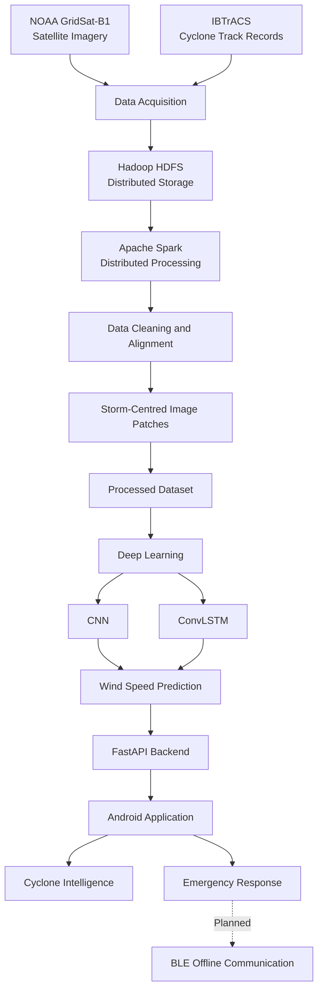

# CycloneConnect

### AI-Powered Cyclone Intelligence and Disaster Management System

CycloneConnect is a research-oriented cyclone intelligence and
disaster-management project focused on the **North Indian Ocean
region**, particularly the Bay of Bengal and Arabian Sea.

The project combines Big Data Analytics, Deep Learning, and Android
application development to address two important challenges during
tropical cyclones:

-   **Cyclone Intelligence:** Analysing satellite imagery to estimate
    cyclone wind speed and intensity.
-   **Disaster Response:** Providing a mobile platform for accessing
    cyclone-related information and supporting emergency coordination,
    including proposed offline communication capabilities.

The system aims to bridge the gap between cyclone analysis and practical
disaster response through an integrated architecture.

------------------------------------------------------------------------

## 1. Problem Statement

Tropical cyclones in the North Indian Ocean pose significant threats to
coastal communities, resulting in loss of life, infrastructure damage,
and communication disruptions.

Conventional cyclone intensity estimation relies heavily on manual
interpretation of satellite imagery. Although deep learning offers
opportunities for automated analysis, training these models requires
large volumes of labelled spatio-temporal data.

Furthermore, during disasters, internet and cellular networks may become
unavailable, making emergency communication and resource coordination
difficult.

**CycloneConnect addresses these challenges through a dual-component
approach:**

1.  A distributed Big Data and Deep Learning pipeline for
    satellite-based cyclone wind-speed estimation.
2.  An Android disaster-management application designed to provide
    cyclone intelligence and support emergency response, with offline
    communication planned through Bluetooth Low Energy (BLE).

------------------------------------------------------------------------

## 2. System Architecture

CycloneConnect follows a modular architecture consisting of a
distributed data-processing pipeline, a deep learning subsystem, a
backend API, and an Android application.

### High-Level Architecture



### Architecture Components

  -----------------------------------------------------------------------
  Component               Technology              Responsibility
  ----------------------- ----------------------- -----------------------
  Data acquisition        NOAA, IBTrACS           Obtain satellite
                                                  imagery and cyclone
                                                  records

  Distributed storage     Hadoop HDFS             Store large-scale
                                                  satellite and processed
                                                  datasets

  Distributed processing  Apache Spark, PySpark   Clean, align, crop and
                                                  prepare satellite data

  Data analysis           MongoDB                 Support storm-record
                                                  storage and complex
                                                  queries

  Deep Learning           TensorFlow/Keras        Train CNN and ConvLSTM
                                                  models

  Backend                 FastAPI                 Expose cyclone-related
                                                  data through REST
                                                  endpoints

  Mobile application      Kotlin, Jetpack Compose Provide the user-facing
                                                  disaster-management
                                                  interface

  On-device inference     TensorFlow Lite         Execute the bundled CNN
                                                  model on Android
  -----------------------------------------------------------------------

### Data Flow

1.  **Acquisition:** Download NOAA GridSat-B1 infrared satellite imagery
    and IBTrACS cyclone best-track records.
2.  **Ingestion:** Load the datasets into HDFS for distributed storage.
3.  **Processing:** Use Spark to clean cyclone records, align
    timestamps, match satellite scans, and extract storm-centred image
    patches.
4.  **Storage:** Store the processed datasets in Parquet format, with
    image patches represented as numerical arrays.
5.  **Model Training:** Prepare the processed images for CNN and
    ConvLSTM training.
6.  **Prediction:** Generate wind-speed estimates using trained deep
    learning models.
7.  **Integration:** Expose cyclone information through the backend and
    integrate prediction functionality into the Android application.

------------------------------------------------------------------------

## 3. Big Data Analytics

The Big Data component addresses the computational challenges involved
in processing large-scale satellite imagery.

### Datasets

**NOAA GridSat-B1**

-   Source:
    https://www.ncei.noaa.gov/data/geostationary-ir-channel-brightness-temperature-gridsat-b1/access/
-   Format: NetCDF
-   Contains global infrared brightness-temperature imagery.
-   Provides satellite observations at three-hour intervals.

**IBTrACS (International Best Track Archive for Climate Stewardship)**

-   Source:
    https://data.humdata.org/dataset/96b309bf-cedb-4f63-8ca3-eb56cdcae876/
-   Format: CSV
-   Contains cyclone identifiers, timestamps, geographical coordinates,
    and wind-speed observations.

### Distributed Processing Pipeline

The project uses Hadoop HDFS and Apache Spark in a two-laptop
distributed environment.

**Hadoop HDFS** - Provides distributed storage across multiple
machines. - Supports block replication and fault tolerance. - Allows
both machines to access a shared dataset.

**Apache Spark** - Performs distributed data processing using PySpark. -
Processes satellite files in parallel. - Handles data cleaning,
timestamp matching, image cropping, and dataset preparation.

**Image Preprocessing** - Matches IBTrACS cyclone records with
corresponding satellite observations. - Extracts fixed-size 64 × 64
pixel patches around cyclone centres. - Retains infrared image channels
for downstream experiments. - Stores processed patches in Parquet
format.

### Intensity Classification Reference

Wind speed observations are interpreted using the following IMD
intensity categories:

  Category                             Wind Speed
  ------------------------------------ --------------------
  Depression (D)                       17--27 knots
  Deep Depression (DD)                 28--33 knots
  Cyclonic Storm (CS)                  34--47 knots
  Severe Cyclonic Storm (SCS)          48--63 knots
  Very Severe Cyclonic Storm (VSCS+)   64 knots and above

------------------------------------------------------------------------

## 4. Deep Learning

The Deep Learning component explores automated cyclone wind-speed
estimation from satellite imagery.

The processed satellite patches are used to train and evaluate two
neural network architectures.

### CNN -- Baseline Model

A Convolutional Neural Network processes a single satellite image.

-   Input: 64 × 64 satellite image.
-   Extracts spatial features from cyclone cloud patterns.
-   Uses convolutional layers, batch normalization, and pooling.
-   Predicts cyclone wind speed in knots.

### ConvLSTM -- Temporal Model

A Convolutional Long Short-Term Memory network processes consecutive
satellite images to learn spatial and temporal patterns.

-   Input: Four satellite images.
-   Each image is separated by three hours.
-   Learns how cyclone structures evolve over time.
-   Predicts cyclone wind speed in knots.

### Model Comparison

The CNN and ConvLSTM experiments were evaluated on the same 1,013 test
observations.

  Evaluation Metric               CNN        ConvLSTM
  ------------------- --------------- ---------------
  MAE                   12.8231 knots   12.5253 knots
  RMSE                  17.6671 knots   17.0156 knots

**Observation:** ConvLSTM achieved slightly better performance, reducing
MAE by 2.32% and RMSE by 3.69% compared with the CNN baseline.

These results apply to the evaluated experimental dataset and should not
be interpreted as operational forecasting accuracy.

### Model Evaluation

The project uses:

-   Mean Absolute Error (MAE)
-   Root Mean Squared Error (RMSE)
-   Training and validation loss
-   Comparative evaluation of CNN and ConvLSTM

------------------------------------------------------------------------

## 5. Android Application

The Android application serves as the user-facing component of
CycloneConnect.

It is developed using Kotlin and Jetpack Compose, with a focus on
accessibility and disaster-response functionality.

### Current Application Structure

-   Home dashboard
-   Location search interface
-   Emergency information section
-   Family and friends section
-   Official cyclone alerts section
-   Regional news section
-   Emergency SOS entry point
-   Volunteer and donation sections
-   Settings and theme customization
-   Experimental cyclone prediction demonstration

### On-Device Cyclone Prediction

The current Android prediction demonstration uses TensorFlow Lite.

The application:

1.  Loads a bundled CNN model (`cyclone_cnn.tflite`).
2.  Reads preprocessing parameters from `preprocessing.json`.
3.  Loads a sample 64 × 64 Channel 1 satellite patch.
4.  Normalizes the image using the stored training mean and standard
    deviation.
5.  Runs inference using the TensorFlow Lite interpreter.
6.  Displays the predicted wind speed in knots.
7.  Derives an intensity category using the IMD wind-speed thresholds.

The current demonstration uses a bundled historical sample rather than
live satellite data.

### Planned Emergency Communication

A major proposed feature is offline emergency communication using
Bluetooth Low Energy (BLE).

The planned functionality includes:

-   Offline SOS message exchange.
-   Bluetooth-based store-and-forward communication.
-   Emergency message prioritization.
-   Decentralized sharing of resource availability.
-   Coordination of food, drinking water, medical assistance, and
    shelter requirements.

An additional proposed feature is on-device SOS message classification
using a 1D-CNN model converted to TensorFlow Lite.

Messages will be classified into three priority levels:

-   **Critical:** Search and rescue, medical assistance, or
    death-related messages.
-   **High:** Requests involving food, water, or shelter.
-   **Low:** Other messages.

These emergency communication and classification features are part of
the proposed system design and are not yet implemented in the current
Android codebase.

------------------------------------------------------------------------

## 6. Backend

The repository includes a FastAPI backend prototype.

Current API endpoints:

  --------------------------------------------------------------------------
  Method                  Endpoint                   Description
  ----------------------- -------------------------- -----------------------
  GET                     `/health`                  Check backend
                                                     availability

  GET                     `/storms`                  Retrieve storm records
                                                     with optional year and
                                                     basin filters

  GET                     `/storms/{sid}/timeline`   Retrieve a storm's
                                                     timeline
  --------------------------------------------------------------------------

The current backend uses sample in-memory storm records and timelines.
Integration with the distributed processing pipeline and trained models
remains future work.

------------------------------------------------------------------------

## 7. Technology Stack

  Category                  Technologies
  ------------------------- ----------------------------------------------
  Programming Languages     Python, Kotlin
  Big Data                  Hadoop HDFS, Apache Spark, PySpark
  Scientific Computing      NumPy, Pandas, xarray, netCDF4, PyArrow
  Data Storage              HDFS, Parquet, MongoDB (planned integration)
  Deep Learning             TensorFlow, Keras
  Model Architectures       CNN, ConvLSTM
  Model Deployment          TensorFlow Lite
  Backend                   Python, FastAPI
  Android Development       Android Studio, Jetpack Compose
  Build System              Gradle, Kotlin DSL
  Distributed Environment   Ubuntu 22.04, WSL2, Tailscale

------------------------------------------------------------------------

## 8. Repository Structure

``` text
CycloneConnect/
│
├── app/
│   └── src/
│       ├── main/
│       │   ├── assets/
│       │   │   ├── cyclone_cnn.tflite
│       │   │   ├── preprocessing.json
│       │   │   ├── sample_channel1.csv
│       │   │   ├── sample_info.json
│       │   │   └── sample_satellite.png
│       │   │
│       │   ├── java/com/example/cycloneconnect/
│       │   │   ├── MainActivity.kt
│       │   │   ├── AppNavigation.kt
│       │   │   ├── CyclonePredictor.kt
│       │   │   └── ui/
│       │   │       ├── screens/
│       │   │       └── theme/
│       │   │
│       │   └── AndroidManifest.xml
│       │
│       └── test/
│
├── backend/
│   └── app/
│       └── main.py
│
├── big_data/
│   ├── download_gridsat.py
│   ├── step5_ibtracs.py
│   ├── step6_match.py
│   ├── step7_patches.py
│   ├── check_patches.py
│   ├── check_runs.py
│   ├── demo_queries.py
│   └── plot_patches.py
│
├── deep_learning/
│   ├── notebooks/
│   │   ├── 01_CNN_Channel1.ipynb
│   │   ├── 02_ConvLSTM_Channel1.ipynb
│   │   └── 03_Model_Comparison.ipynb
│   │
│   └── src/
│       ├── __init__.py
│       ├── preprocessing.py
│       ├── create_sequences.py
│       ├── model.py
│       ├── train.py
│       └── evaluate.py
│
├── gradle/
├── build.gradle.kts
├── settings.gradle.kts
├── requirements.txt
└── README.md
```

### Directory Description

  -----------------------------------------------------------------------
  Directory                           Purpose
  ----------------------------------- -----------------------------------
  `app/`                              Android application and on-device
                                      CNN inference

  `backend/`                          FastAPI backend prototype

  `big_data/`                         Satellite acquisition, distributed
                                      processing, and dataset preparation
                                      scripts

  `deep_learning/notebooks/`          CNN, ConvLSTM, and model comparison
                                      experiments

  `deep_learning/src/`                Reusable preprocessing, model
                                      building, training, and evaluation
                                      modules

  `gradle/`                           Android build configuration and
                                      dependency management
  -----------------------------------------------------------------------

------------------------------------------------------------------------

## 9. Getting Started

### A. Android Application

**Requirements** - Android Studio - Android SDK - JDK 11-compatible
build environment

**Steps**

1.  Clone the repository:

``` bash
git clone https://github.com/<username>/CycloneConnect.git
```

2.  Open the project in Android Studio.
3.  Allow Gradle to synchronize dependencies.
4.  Connect an Android device or start an emulator.
5.  Run the `app` configuration.

The repository currently includes a sample satellite image and a bundled
TensorFlow Lite CNN model for the experimental prediction demonstration.

### B. Deep Learning Experiments

**Requirements** - Python 3 - Google Colab or a compatible local Python
environment - Access to the prepared satellite datasets

Install the Python dependencies:

``` bash
pip install -r requirements.txt
```

Run the notebooks in the following order:

``` text
01_CNN_Channel1.ipynb
02_ConvLSTM_Channel1.ipynb
03_Model_Comparison.ipynb
```

The notebooks require the prepared datasets generated by the Big Data
processing pipeline.

### C. Backend

Install FastAPI and Uvicorn:

``` bash
pip install fastapi uvicorn
```

Navigate to the repository root and start the backend:

``` bash
uvicorn backend.app.main:app --reload
```

Access the API documentation at:

``` text
http://127.0.0.1:8000/docs
```

Check backend availability:

``` text
http://127.0.0.1:8000/health
```

### D. Big Data Pipeline

The Big Data scripts are designed to run in a configured Hadoop and
Spark environment.

The intended workflow is:

1.  Configure the two-node Hadoop HDFS and Spark cluster.
2.  Download and ingest GridSat-B1 imagery.
3.  Ingest and clean IBTrACS records.
4.  Match cyclone records with satellite timestamps.
5.  Extract storm-centred image patches.
6.  Store processed datasets in HDFS.

The scripts use predefined HDFS directories under `/project/`. Configure
the cluster and required paths before executing them.

------------------------------------------------------------------------

## 10. Research Gaps Addressed

The project is motivated by the following research and implementation
gaps:

  -----------------------------------------------------------------------
  Identified Gap                      Proposed Approach
  ----------------------------------- -----------------------------------
  Disconnect between cyclone          Integrate cyclone intelligence and
  forecasting and disaster response   emergency coordination in one
                                      application

  Dependence on cellular networks and BLE-based offline communication
  internet                            

  Lack of decentralized resource      Offline sharing of emergency
  coordination                        requirements and available
                                      resources

  Computational challenges in deep    Distributed data processing and
  learning                            cloud-based training

  Difficulty prioritizing emergency   On-device NLP-based SOS
  messages                            classification
  -----------------------------------------------------------------------

------------------------------------------------------------------------

## 11. Future Scope

-   Integrate live satellite data acquisition.
-   Extend the prediction system to support more cyclone observations
    and geographical regions.
-   Explore additional satellite channels and temporal sequence lengths.
-   Improve wind-speed prediction performance.
-   Integrate the trained ConvLSTM model with the backend.
-   Develop a complete cyclone tracking and visualization interface.
-   Implement BLE-based offline SOS communication.
-   Implement on-device emergency message classification.
-   Develop decentralized emergency resource coordination.
-   Integrate official cyclone bulletins and alerts.

------------------------------------------------------------------------

## 12. Disclaimer

CycloneConnect is an academic research prototype developed to explore
the application of Big Data Analytics and Deep Learning in cyclone
intelligence and disaster management.

Its experimental predictions are not substitutes for official
meteorological forecasts, warnings, or evacuation instructions.

For operational cyclone warnings, always follow official advisories
issued by the India Meteorological Department (IMD) and relevant
disaster-management authorities.

------------------------------------------------------------------------

## 13. Contributors

**Project Team**

-   Hema Shree G
-   Sinchana B M

**Institution:** BMS College of Engineering

**Project Focus:** Big Data Analytics, Deep Learning, and Android
Application Development.
